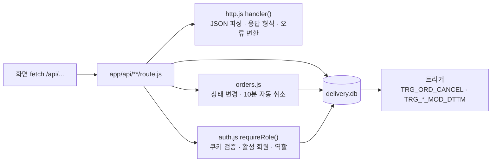
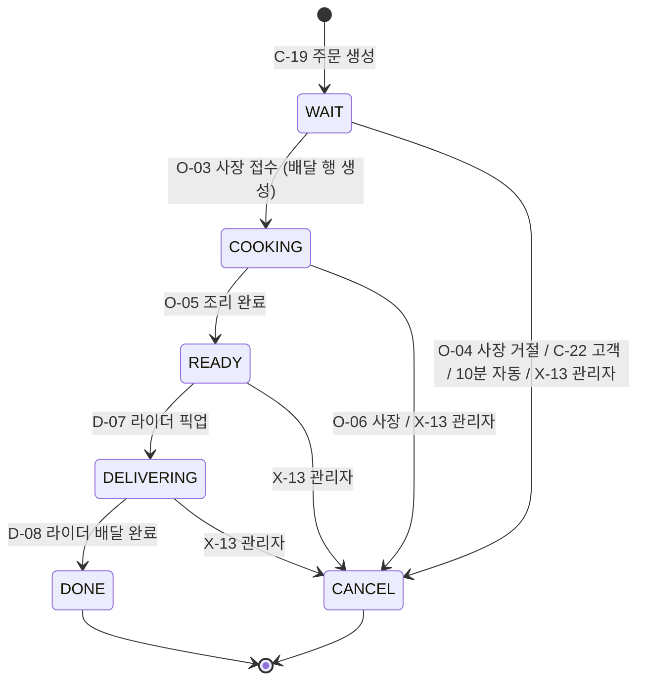

# 백엔드 안내

이 문서는 우리 백엔드의 입구다. 처음 보는 팀원과 AI 에이전트가 이 문서 하나로 구조를 파악하고 화면을 연결하거나 기능을 고칠 수 있게 쓴다. API 하나하나의 요청·응답·오류는 [docs/api/](api/README.md)에 있다. 이 문서는 그 내용을 복사하지 않고 링크한다.

## 1. 한눈에 보기

- 고객·사장·라이더·관리자가 쓰는 배달 주문 서비스의 API다.
- API는 93개다(인증 A, 고객 C, 사장 S·M·O·R·T, 관리자 X, 라이더 D).
- Next.js 프로젝트 하나가 화면과 API를 함께 실행한다. 별도 백엔드 서버는 없다.
- DB는 SQLite 파일 하나(`delivery.db`)다.

| 항목 | 내용 |
|---|---|
| 런타임 | Node.js 24 |
| 프레임워크 | Next.js 16.4.5 (App Router, Route Handler) |
| DB | SQLite, `better-sqlite3` 12.11.1 (동기식 API) |
| 비밀번호 | Node 내장 `crypto.scrypt` |
| 세션 | HMAC 서명 쿠키 (Node 내장 `crypto`) |
| 추가 의존성 | 없음 (zod 등 쓰지 않음) |

### 폴더 구조

| 경로 | 역할 |
|---|---|
| `app/api/**/route.js` | API 하나의 진입점. 경로는 문서의 path와 같다(`{storeId}` → `[storeId]` 폴더). SQL은 기본적으로 여기 둔다. |
| `lib/db.js` | DB 연결. `process.cwd()/delivery.db`를 열고 외래키 검사를 켠다. |
| `lib/password.js` | `hashPassword`, `verifyPassword` (scrypt). |
| `lib/server/http.js` | `handler()`(응답 형식·오류 변환), `fail()`, `readJson()`, 입력 검사 helper(`str`, `int`, `oneOf` 등), 페이지 helper. |
| `lib/server/auth.js` | 세션 쿠키 발급·검증, `requireRole()`, `requireOwnStore()`. |
| `lib/server/orders.js` | 주문 상태 변경(`transitionOrder`, `cancelOrder`)과 10분 미접수 자동 취소(`expireWaitingOrders`). |
| `lib/server/geo.js` | 라이더 기준 좌표 상수(`RIDER_BASE`), 배달 반경(3000m), 거리 계산. |
| `lib/server/stores.js` | 가게 영업 상태 계산(OPEN·PAUSED·CLOSED), 영업시간 응답. |
| `lib/server/members.js` | 회원 응답 형태, 비밀번호 입력 검사, 가게 신청 입력 검사·저장 (A-01, A-03, A-05, A-06, A-08). |
| `lib/server/cart.js` | 장바구니 읽기·금액 계산, 주문 가능 검사와 주문 생성 (C-13~C-19). |
| `lib/server/customer-stores.js` | 고객 주소 확인, 고객용 가게 조회 공용 로직 (C-03~C-05, C-08~C-12). |
| `lib/server/owner-menus.js` | 사장 가게 상세, 메뉴·분류·옵션 공용 로직 (S, M). |
| `lib/server/owner-orders.js` | 사장 가게·주문 확인, 매출 기간 계산 같은 공용 로직 (O, R, T). |
| `lib/server/admin.js` | 활성 제재 조건, 관리자 취소 가능 상태. |
| `lib/server/rider.js` | 라이더 배달 응답 조회. |
| `db/schema.sql` | 테이블 23개, CHECK·UNIQUE·FK·인덱스. |
| `db/views.sql` | VIEW 2개. |
| `db/triggers.sql` | 트리거 18개. |
| `db/seed.sql` | 시연 데이터. |
| `scripts/init-db.mjs` | DB 초기화 (`npm run db:init`). |
| `scripts/db-check.mjs` | 스키마·트리거·VIEW 검사 (`npm run db:check`). |
| `scripts/api-smoke.mjs` | 실제 HTTP로 주요 흐름 확인 (`npm run api:smoke`). |
| `docs/api/` | API 계약 문서. [README.md](api/README.md)(공통 규칙·코드값·전체 목록), [auth.md](api/auth.md), [customer.md](api/customer.md), [owner.md](api/owner.md), [admin.md](api/admin.md), [rider.md](api/rider.md). |

## 2. 실행 방법

```sh
node -v              # v24.x 여야 한다
npm ci               # 의존성 설치
npm run db:init      # delivery.db 를 지우고 schema → views → triggers → seed 순서로 다시 만든다
npm run dev          # http://localhost:3000
```

- seed 없이 빈 DB가 필요하면 `npm run db:init -- --empty`를 실행한다.
- `npm run db:init`은 기존 `delivery.db`를 지운다. 개발 서버가 켜져 있으면 서버는 지워진 파일을 계속 쓴다. 초기화한 뒤에는 개발 서버를 다시 켠다.
- Windows PowerShell에서 npm이 막히면 `npm.cmd`를 쓴다.

### 환경변수

| 이름 | 쓰는 곳 | 필수 여부 |
|---|---|---|
| `SESSION_SECRET` | 세션 쿠키 서명 키 (`lib/server/auth.js`) | production(`npm run build` 후 `npm run start`)에서 필수. 없으면 로그인과 인증이 필요한 요청이 모두 500이다. 개발(`npm run dev`)에서는 없으면 개발용 기본값을 쓴다. |
| `NEXT_PUBLIC_USE_MOCK` | 화면의 api.js | `false`면 화면이 실제 `/api`를 부른다. 아래 3절 참고. |
| `NEXT_PUBLIC_API_BASE` | 화면의 api.js | 화면과 API가 같은 Next.js에서 돌므로 비워 둔다. |

- 서버 시간대는 한국 시간이라고 가정한다. 일시는 SQLite `datetime('now', 'localtime')`으로 기록한다.

### 시연 계정 (`npm run db:init` 후)

모든 계정의 비밀번호는 `test1234`다.

| 역할 | 이메일 | 회원 ID | 참고 |
|---|---|---|---|
| 관리자 | `admin@test.com` | 1 | |
| 사장 | `owner1@test.com` ~ `owner3@test.com` | 2~4 | 가게 1~3 승인, 4 대기, 5 반려 |
| 라이더 | `rider1@test.com` ~ `rider4@test.com` | 5~8 | |
| 고객 | `customer1@test.com` ~ `customer4@test.com` | 9~12 | 포인트 잔액과 주문 이력이 있다 |
| 탈퇴 회원 | - | 13 | 로그인할 수 없다 |

- seed의 WAIT 주문 2건은 `db:init` 시각 기준 1~2분 전에 들어간다. 10분이 지나면 자동 취소 대상이 된다.

## 3. 화면 연결

- 화면 브랜치의 api.js는 기본으로 가짜 서버(mock)를 쓴다.
- 실제 API를 쓰려면 프로젝트 루트의 `.env.local`에 아래 한 줄을 넣고 개발 서버를 다시 켠다.

```sh
NEXT_PUBLIC_USE_MOCK=false
```

### 공통 형식
- 요청 본문은 JSON이다.
- 성공: `{ "success": true, "data": ... }`
- 실패: `{ "success": false, "error": { "code": "...", "message": "...", "fields": { ... } } }`. `fields`는 입력 오류(400)일 때만 있다.
- 화면은 `message`를 보여 주고, 분기는 `code`로 한다.
- 페이지 목록은 `data = { items, page, size, totalCount }`다. 페이지가 없는 목록은 `data`가 배열이다.
- 자세한 규칙과 오류 코드는 [api/README.md](api/README.md#공통-규칙)에 있다.

### 세션
- 로그인(A-01)하면 서버가 `delivery_session` 쿠키를 준다(HttpOnly, 24시간).
- 화면은 쿠키를 직접 다루지 않는다. `fetch`에 `credentials: 'include'`만 주면 된다(화면 api.js가 이미 그렇게 한다).
- 서버는 요청마다 회원이 활성 상태인지와 역할을 다시 확인한다.

### 화면 api.js와 다른 점
- 사장·관리자·라이더 api.js의 method와 path는 모두 문서와 같다. 경로를 바꾼 API는 없다.
- 새로 생긴 API: A-08 내 정보 수정 `PATCH /api/auth/me` (이름·연락처·비밀번호). 화면에 함수를 추가해야 한다.
- X-13 관리자 주문 취소: 요청 본문에 `reasonDetail`이 생겼다. 사유가 `ETC`면 필수다. 관리자 취소 화면에 입력 칸을 추가해야 한다.
- C-24·C-25 리뷰 내용: 생략하거나 빈 문자열이면 `null`로 저장한다. 응답의 `content`는 `null`일 수 있다.
- 사장 경로의 `{storeId}`: 없거나 삭제된 가게면 404, 다른 사장의 가게면 403이다.
- 그 밖에 필드 이름 복원, 응답 보완 같은 API별 차이는 [api/README.md의 "원본 명세서 대비 변경"](api/README.md#원본-명세서-대비-변경)에 있다.

## 4. 요청 흐름



주문 상태는 아래처럼만 바뀐다. 표에 없는 변경은 409 `ORDER_ALREADY_PROCESSED`다.



- 라이더 배차(D-05)는 주문 상태를 바꾸지 않는다. COOKING·READY 주문에 배차를 받을 수 있다.
- 10분 미접수 자동 취소는 예약 작업이 아니다. 주문을 읽는 API가 조회 전에 만료된 WAIT 주문을 SYSTEM 취소한다. 접수·거절·고객 취소는 같은 트랜잭션에서 만료를 확인하고, 만료면 자동 취소를 커밋한 뒤 409를 준다.

## 5. DB

### 테이블 23개

| 테이블 | 한 줄 설명 |
|---|---|
| `TB_MBR` | 회원 공통 계정. 역할(CUSTOMER·OWNER·RIDER·ADMIN), 상태(ACTIVE·WITHDRAWN), 포인트 잔액. |
| `TB_MBR_ADDR` | 고객 배달 주소. 좌표 필수, 회원당 기본 주소 1개. |
| `TB_RIDER` | 라이더 전용 정보. 상태(IDLE·BUSY), 운송수단, 활동 반경. |
| `TB_STORE` | 가게. 카테고리, 좌표, 최소 주문금액, 배달팁, 기본 조리시간, 영업 상태, 현재 승인 상태. |
| `TB_STORE_HOURS` | 요일별 영업시간. 한 요일에 여러 행이면 브레이크타임, 행이 없으면 휴무. |
| `TB_STORE_APRV` | 입점 신청·승인·반려 이력. 재신청하면 새 행. |
| `TB_MENU_CTGR` | 가게 안 메뉴 분류. |
| `TB_MENU` | 메뉴. 금액, 판매 상태(ON_SALE·SOLD_OUT). |
| `TB_MENU_OPT_GRP` | 메뉴의 옵션 그룹. 필수 여부, 최대 선택 수. |
| `TB_MENU_OPT` | 옵션 그룹의 옵션. 추가 금액. |
| `TB_CART` | 회원당 장바구니 1개. 한 가게의 메뉴만 담는다. |
| `TB_CART_DTL` | 장바구니 항목. 같은 메뉴라도 옵션 구성이 다르면 별도 행. |
| `TB_CART_DTL_OPT` | 장바구니 항목의 선택 옵션. |
| `TB_ORD` | 주문. 상태, 금액(배달팁 제외)·배달팁, 배달지 스냅샷, 접수·취소 정보. |
| `TB_ORD_DTL` | 주문 메뉴. 메뉴명·단가 스냅샷. |
| `TB_ORD_DTL_OPT` | 주문 옵션. 옵션 그룹명·옵션명·금액 스냅샷. |
| `TB_PAY` | 결제. 주문당 1건, 수단(CARD·KAKAO·NAVER·POINT), 상태. |
| `TB_PNT_TXN` | 포인트 원장. CHARGE·USE·REFUND·EXPIRE, 거래 후 잔액. |
| `TB_DLVR` | 배달. 사장 접수 때 생성. 라이더·배차·픽업·완료 일시(상태 컬럼 없음). |
| `TB_RVW` | 리뷰. 주문당 1건, 평점 1~5, 내용 NULL 허용, 숨김·삭제 여부. |
| `TB_RVW_REPLY` | 사장 답글. 리뷰당 1건(삭제 후 다시 달면 행을 되살림). |
| `TB_RVW_RPT` | 리뷰 신고와 관리자 처리 결과. |
| `TB_MBR_RSTR` | 리뷰 작성 제한 이력. 종료일시가 NULL이거나 미래면 활성. |

- 테이블은 SQLite STRICT다. 일시는 TEXT `YYYY-MM-DD HH:MM:SS`, 금액은 원 단위 INTEGER다.
- 컬럼 정의와 제약은 `db/schema.sql`의 주석에 있다.

### VIEW 2개

| VIEW | 내용 | 쓰는 API |
|---|---|---|
| `V_STORE_RATING` | 가게별 평균 평점(소수 1자리)·리뷰 수. 숨김·삭제 리뷰 제외. 리뷰 0건 가게도 행이 있다(평점 NULL). | C-08, C-09, C-12, S-01, R-01 |
| `V_DONE_ORDER` | 배달 완료(DONE) 주문. 매출 날짜 = 배달 완료 날짜, 주문금액(배달팁 제외), 배달팁. | T-01, T-02 |

### 트리거 18개

| 트리거 | 언제 | 무엇을 |
|---|---|---|
| `TRG_<테이블>_MOD_DTTM` (17개) | MOD_DTTM이 있는 테이블을 UPDATE한 뒤 | UPDATE에서 MOD_DTTM을 직접 바꾸지 않았으면 현재 시각을 기록한다. |
| `TRG_ORD_CANCEL` | `TB_ORD.ORD_STTS`가 CANCEL로 바뀐 뒤 (주문마다) | 결제를 CANCELED로 바꾼다. 승인된 POINT 결제면 잔액을 돌려주고 REFUND 거래를 기록한다. 배차된 라이더의 배달이 끝나지 않았으면 라이더를 IDLE로 돌린다. |

**트리거가 하는 일은 코드에서 다시 하지 않는다.**
- 주문 취소 API는 `TB_ORD`를 CANCEL로 바꾸기만 한다. 결제 취소·환불·라이더 IDLE은 트리거가 한다.
- UPDATE 문에 `MOD_DTTM`을 넣지 않는다.
- 다시 하면 이중 환불이 생긴다. `TB_PNT_TXN`의 부분 UNIQUE 인덱스(주문당 REFUND 1건)가 마지막으로 막는다.

트리거가 하지 않고 API가 같은 트랜잭션에서 하는 일:
- 배차 수락 때 라이더 BUSY (D-05)
- 배달 완료 때 라이더 IDLE (D-08)
- 입점 승인 상태 동기화: `TB_STORE_APRV`와 `TB_STORE.STORE_APRV_STTS` (A-05, X-03, X-04)

## 6. 원본 명세서·ERD와 달라진 결정

| 결정 | 이유 |
|---|---|
| 라이더 위치는 숭실대 좌표 상수(37.4963, 126.9575). `TB_RIDER`에 기준 좌표 컬럼 없음 | 최신 라이더 명세(D-04) 기준. 상수는 `lib/server/geo.js` 한 곳에만 둔다. |
| 운송수단 4개: WALK, BICYCLE, MOTORCYCLE, CAR | 라이더 명세 기준. OTHER 제거. |
| 리뷰 내용 `RVW_CN` NULL 허용. 생략·빈 문자열이면 NULL | 11/12 ERD 기준. 고객 명세의 "빈 문자열 저장" 문구는 고쳤다. |
| 가게 카테고리 8개: CHICKEN, PIZZA, KOREAN, CHINESE, JAPANESE, SNACK, CAFE, ETC | 명세에서 미확정이던 코드를 임시 8개로 확정. |
| 여러 테이블에 걸친 검사는 서버 코드가 한다 | 리뷰 작성 조건, 장바구니 가게 일치, 답글 작성자, 활성 제재 중복, 주문↔배달 상태는 SQLite CHECK로 표현할 수 없다. 검사용 트리거는 만들지 않았다. |
| 한 테이블 안의 규칙은 스키마 제약으로 넣었다 | 취소 상태 ⇔ 취소 일시·주체, 접수 이후 ⇔ 접수 일시·조리분, 회원당 기본 주소 1개, 배차 ≤ 픽업 ≤ 완료 등. DB가 마지막 방어선이다. |
| 탈퇴한 회원의 이메일로 다시 가입할 수 있다 | 이메일은 활성 회원 사이에서만 UNIQUE(`UK_MBR_EMAIL_ACTIVE`). 탈퇴 행은 원래 이메일을 유지해 과거 주문을 추적할 수 있다. |
| 취소 사유 코드는 취소 주문에 필수. 고객 취소는 `CUSTOMER_REQUEST`, 자동 취소는 `NO_RESPONSE` | 명세서 기준(팀 결정). |
| `TB_STORE.COOK_EST_MI`는 기본 조리시간(분) | 11/12 ERD의 `DLVR_EST_MI` → `COOK_EST_MI` 변경. |
| `TB_DLVR`에 상태 컬럼 없음 | 주문 상태와 겹친다. 배차·픽업·완료는 일시 컬럼으로 판단한다(11/12 ERD). |
| 포인트 1회 충전 상한 없음(10,000원 단위) | 팀 결정. |
| 장바구니 항목 수량 상한 없음 | 팀 결정. |
| `replaceCart=true`면 기존 장바구니를 비우고 새 가게로 교체 | 팀 결정. |
| 같은 메뉴·같은 옵션 구성이면 수량 합산, 옵션이 다르면 별도 항목 | 팀 결정. |
| 판매 중인 메뉴가 0개가 되어도 가게 영업 상태는 그대로, 주문만 막는다 | 팀 결정. 주문 API(C-18, C-19)의 판매 가능 검사가 막는다. |
| X-13 관리자 취소에 `reasonDetail` 추가(ETC면 필수) | 팀 결정. 상담 메모와 취소 상세 사유를 구분한다. |
| A-08 `PATCH /api/auth/me` 신설 | 팀 결정. 라이더 명세가 안내한 이름·연락처·비밀번호 수정 기능. |
| 사장이 탈퇴하면 소유 가게를 모두 논리 삭제하고 PAUSED로 | 팀 결정. |
| 세션은 HMAC 서명 쿠키, production에서는 `SESSION_SECRET` 필수 | 세션 테이블 없이 구현한다. 공개된 개발 키로 쿠키를 위조하지 못하게 한다. |

- API별 세부 변경은 [api/README.md의 "원본 명세서 대비 변경"](api/README.md#원본-명세서-대비-변경)에 있다.

## 7. 새 API 추가·수정 방법

1. 먼저 문서를 고친다. 해당 영역 문서(`docs/api/<영역>.md`)에 같은 틀(요청·응답·오류·DB 처리)로 쓰고, `docs/api/README.md`의 전체 API 목록에 한 줄 추가한다.
2. `app/api/<경로>/route.js`를 만든다. 경로의 `{x}`는 `[x]` 폴더다.
3. route 모양은 아래와 같다.

```js
import db from "@/lib/db";
import { requireRole } from "@/lib/server/auth";
import { fail, handler, pathId, readJson, str } from "@/lib/server/http";

export const runtime = "nodejs";

// PATCH /api/customer/addresses/{addressId} 의 축약 예
export const PATCH = handler(async ({ request, params }) => {
  const me = requireRole(request, "CUSTOMER");          // 401·403 은 여기서 끝난다
  const addressId = pathId(params.addressId, "addressId");
  const body = await readJson(request);
  const name = str(body.addressName, "addressName", { max: 30 }); // 잘못되면 400 VALIDATION_ERROR

  const address = db.prepare("SELECT MBR_ID FROM TB_MBR_ADDR WHERE MBR_ADDR_ID = ? AND DEL_YN = 'N'").get(addressId);
  if (!address) fail(404, "NOT_FOUND", "주소를 찾을 수 없습니다.");
  if (address.MBR_ID !== me.MBR_ID) fail(403, "FORBIDDEN", "내 주소가 아닙니다.");

  db.prepare("UPDATE TB_MBR_ADDR SET MBR_ADDR_NM = ? WHERE MBR_ADDR_ID = ?").run(name, addressId); // MOD_DTTM 은 트리거
  return { addressId, addressName: name };               // 200 { success: true, data }
});
```

- 201이 필요하면 `return created({ ... })`를 쓴다(`@/lib/server/http`).
- 쿠키를 설정하려면 `return ok(data, { headers: { "Set-Cookie": ... } })`를 쓴다.
- 사장 경로는 `requireOwnStore(me, storeId)`로 가게 소유를 확인한다.
- 여러 테이블(또는 여러 행)을 쓰면 `db.transaction(() => { ... })()` 하나로 묶는다.
- 주문 상태를 바꾸려면 반드시 `lib/server/orders.js`의 `transitionOrder()` 또는 `cancelOrder()`를 쓴다. 주문을 읽는 API는 먼저 `expireWaitingOrders()`를 호출한다.
- SQL은 route.js 안에 둔다. 두 개 이상의 route가 쓰는 로직만 `lib/server/`로 옮긴다.
4. `scripts/api-smoke.mjs`에 그 흐름을 확인하는 단계를 추가한다(중요한 흐름만).
5. 아래 8절의 검증을 실행한다.

## 8. 검증 방법

| 명령 | 확인하는 것 |
|---|---|
| `npm run db:check` | 메모리 DB에서 트리거(취소 환불·라이더 IDLE·일괄 자동 취소·MOD_DTTM), VIEW, CHECK, 탈퇴 이메일 재가입을 assert로 확인한다. |
| `npm run lint` | ESLint |
| `npm run build` | 프로덕션 빌드 |
| `npm run api:smoke` | `delivery.db`를 초기화하고 빌드 결과로 서버(`next start -p 3210`)를 띄운 뒤 시연 계정으로 실제 HTTP를 호출한다. 로그인·권한·입력 오류·주문~배달~리뷰~매출·취소 환불·관리자 취소·10분 만료·재가입 8개 시나리오. 먼저 `npm run build`가 필요하다. |
| `SMOKE_BASE_URL=http://localhost:3000 node scripts/api-smoke.mjs` | 이미 켜 둔 개발 서버에 붙어 실행한다. DB를 초기화하지 않으므로 앞선 실행으로 데이터가 바뀌었으면 실패할 수 있다. |

- 각 명령은 실패하면 0이 아닌 exit code를 낸다.

## 9. AI 에이전트용 요약

지켜야 할 불변 규칙:
- API 계약은 `docs/api/`다. 경로·필드·오류 코드를 바꾸면 문서를 먼저 고친다.
- 응답은 항상 `handler()`를 거친다. 성공 `{ success: true, data }`, 실패 `{ success: false, error: { code, message, fields? } }`.
- 인증은 `requireRole()`로 한다. 쿠키의 역할을 믿지 않고 요청마다 `TB_MBR`을 읽는다.
- 주문 상태 변경은 `lib/server/orders.js`로만 한다. 조건부 UPDATE이고, 바뀐 행이 0이면 409다.
- 트리거가 하는 일(취소 후 결제 취소·환불·라이더 IDLE, `MOD_DTTM`)은 코드에서 다시 하지 않는다.
- 라이더 BUSY(D-05)·IDLE(D-08)과 입점 승인 상태 동기화는 API가 같은 트랜잭션에서 한다.
- 여러 테이블 쓰기는 `db.transaction()` 하나로 묶는다.
- 여러 테이블에 걸친 검사는 서버 코드가 한다. 한 테이블 안의 규칙은 스키마 제약이 마지막으로 막는다.
- 라이더 기준 좌표는 `lib/server/geo.js`의 `RIDER_BASE` 하나뿐이다.
- 현재 시각은 SQL `datetime('now', 'localtime')`로 쓴다.
- 새 npm 의존성을 추가하지 않는다.
- 스키마를 바꾸면 `npm run db:init`, `npm run db:check`를 다시 실행한다.
- 레포 루트의 `AGENTS.md`는 `next dev`가 만드는 파일이다. 커밋하지 않는다.
