# 개념 데이터 모델

배달 주문 플랫폼이 다루는 엔터티와 엔터티 사이의 관계를 정리한 문서다. 구현 정보(테이블 이름, 타입, FK 컬럼, 인덱스)는 넣지 않았다. 구현 정보는 `logical.md`(릴레이션 스키마)와 `physical.md`(DDL)에 있다.

- 기준: `main` 커밋 `c9f4ae0`(PR #7 merge)의 `server/db/schema.sql`
- 그림 두 가지
  - 아래 "ER 다이어그램": 까마귀발(Crow's Foot) 표기. Markdown에서 바로 보인다. 같은 그림을 `conceptual-erd.png`로도 저장했다.
  - `conceptual.drawio`: Chen 표기(엔터티 사각형, 관계 마름모, 속성 타원). [diagrams.net](https://app.diagrams.net)에서 연다.
- 규모: 엔터티 21개, 관계 35개

## 사용자 역할

회원은 역할 하나를 갖는다. 역할마다 하는 일이 다르다.

| 역할 | 하는 일 |
|---|---|
| 고객 | 주소 등록, 장바구니, 주문·결제, 포인트 충전, 리뷰 작성 |
| 사장 | 가게 입점 신청, 메뉴·영업시간 관리, 주문 접수·취소, 리뷰 답글, 리뷰 신고 |
| 라이더 | 배차 수락, 픽업, 배달 완료, 배달팁 확인 |
| 관리자 | 입점 심사, 리뷰 신고 처리, 회원 제한, 고객센터 주문 취소 |

## ER 다이어그램

선 끝 기호: `||` 정확히 하나, `|o` 없거나 하나, `|{` 하나 이상, `o{` 없거나 여럿. 엔터티 상자에는 식별자와 대표 속성만 적었다.

식별자는 DB가 모든 행에서 유일함을 보장하는 값만 썼다. 이름·별칭·일시처럼 겹칠 수 있는 값은 일반 속성으로 두고, 그런 엔터티는 번호로 식별한다.

```mermaid
erDiagram
    MEMBER["회원"] {
        int member_no "식별자: 회원번호"
        string email "이메일"
    }
    ADDRESS["회원주소"] {
        int address_no "식별자: 주소번호"
        string alias "주소별칭"
    }
    RIDER["라이더"] {
        string member "식별자: 회원"
        string vehicle "운송수단"
    }
    STORE["가게"] {
        string biz_no "식별자: 사업자번호"
        string name "가게명"
    }
    HOURS["영업시간"] {
        int hours_no "식별자: 영업시간번호"
        string day "요일"
    }
    APPLICATION["입점신청"] {
        int application_no "식별자: 신청번호"
        string status "심사상태"
    }
    CATEGORY["메뉴분류"] {
        int category_no "식별자: 분류번호"
        string name "분류명"
    }
    MENU["메뉴"] {
        int menu_no "식별자: 메뉴번호"
        string name "메뉴명"
    }
    OPTION_GROUP["옵션그룹"] {
        int group_no "식별자: 옵션그룹번호"
        string name "그룹명"
    }
    OPTION["옵션"] {
        int option_no "식별자: 옵션번호"
        string name "옵션명"
    }
    CART["장바구니"] {
        string member "식별자: 회원"
        string added_at "담은일시"
    }
    CART_ITEM["장바구니항목"] {
        int item_no "식별자: 항목번호"
        int qty "수량"
    }
    ORDER["주문"] {
        int order_no "식별자: 주문번호"
        string status "주문상태"
    }
    ORDER_ITEM["주문항목"] {
        int seq "식별자: 주문순번"
        int qty "수량"
    }
    PAYMENT["결제"] {
        int pay_no "식별자: 결제번호"
        string method "결제수단"
    }
    POINT_TXN["포인트거래"] {
        int txn_no "식별자: 거래번호"
        string type "거래유형"
    }
    DELIVERY["배달"] {
        int delivery_no "식별자: 배달번호"
        string done_at "완료일시"
    }
    REVIEW["리뷰"] {
        string order "식별자: 주문"
        int rating "평점"
    }
    REPLY["답글"] {
        string review "식별자: 리뷰"
        string content "내용"
    }
    REPORT["리뷰신고"] {
        string reporter_review "식별자: 신고자+리뷰"
        string status "처리상태"
    }
    RESTRICTION["회원제한"] {
        int restriction_no "식별자: 제한번호"
        string type "제한유형"
    }

    MEMBER ||--o{ ADDRESS : "등록"
    MEMBER ||--o| RIDER : "ISA"
    MEMBER ||--o{ STORE : "소유"
    STORE ||--o{ HOURS : "운영"
    STORE ||--o{ APPLICATION : "신청"
    MEMBER |o--o{ APPLICATION : "심사"
    STORE ||--o{ CATEGORY : "구성"
    CATEGORY ||--o{ MENU : "포함"
    MENU ||--o{ OPTION_GROUP : "보유"
    OPTION_GROUP ||--o{ OPTION : "구성"
    MEMBER ||--o| CART : "보유"
    STORE ||--o{ CART : "대상"
    CART ||--o{ CART_ITEM : "담음"
    MENU ||--o{ CART_ITEM : "선택"
    CART_ITEM }o--o{ OPTION : "옵션선택"
    MEMBER ||--o{ ORDER : "주문함"
    STORE ||--o{ ORDER : "접수"
    MEMBER |o--o{ ORDER : "취소처리"
    ORDER ||--|{ ORDER_ITEM : "포함"
    MENU ||--o{ ORDER_ITEM : "선택"
    ORDER_ITEM }o--o{ OPTION : "옵션선택"
    ORDER ||--|| PAYMENT : "결제"
    MEMBER ||--o{ POINT_TXN : "거래"
    ORDER |o--o{ POINT_TXN : "연관"
    ORDER ||--o| DELIVERY : "배달"
    RIDER |o--o{ DELIVERY : "수행"
    ORDER ||--o| REVIEW : "평가"
    REVIEW ||--o| REPLY : "답변"
    MEMBER ||--o{ REPLY : "작성"
    REVIEW ||--o{ REPORT : "신고됨"
    MEMBER ||--o{ REPORT : "신고"
    MEMBER |o--o{ REPORT : "처리"
    MEMBER ||--o{ RESTRICTION : "제한됨"
    REPORT |o--o{ RESTRICTION : "근거"
    MEMBER ||--o{ RESTRICTION : "부과"
```

## 엔터티

| 업무 영역 | 엔터티 | 뜻 | 식별자 | 주요 속성 |
|---|---|---|---|---|
| 회원 | 회원 | 플랫폼에 가입한 사람. 역할은 고객·사장·라이더·관리자 중 하나 | 회원번호 | 이메일(활성 회원 사이에서만 유일), 이름, 전화번호, 역할, 상태(활성·탈퇴), 포인트 잔액 |
| 회원 | 회원주소 | 고객이 등록한 배달 주소 | 주소번호 | 주소별칭, 도로명주소, 상세주소, 우편번호, 위도·경도, 기본 주소 여부 |
| 회원 | 라이더 | 배달을 하는 회원. 회원의 하위 유형 | 회원 | 운송수단, 활동 반경, 상태(대기·배달 중) |
| 회원 | 회원제한 | 관리자가 회원에게 건 이용 제한 | 제한번호 | 제한유형(리뷰 작성), 시작·종료 일시, 사유 |
| 가게·메뉴 | 가게 | 사장이 운영하는 음식점 | 사업자번호 | 가게명, 업종, 주소, 최소 주문 금액, 배달팁, 조리 예상 시간, 운영 상태, 승인 상태 |
| 가게·메뉴 | 영업시간 | 가게가 요일별로 문을 여는 시간대 | 영업시간번호 | 요일, 시작시각, 종료시각 |
| 가게·메뉴 | 입점신청 | 가게를 플랫폼에 올리려는 신청과 그 심사 | 신청번호 | 신청일시, 심사상태, 처리일시, 반려 사유 |
| 가게·메뉴 | 메뉴분류 | 가게 안에서 메뉴를 묶는 분류 | 분류번호 | 분류명(가게 안의 삭제되지 않은 분류 사이에서만 유일), 표시순서 |
| 가게·메뉴 | 메뉴 | 가게가 파는 음식 | 메뉴번호 | 메뉴명, 가격, 설명, 판매 상태(판매 중·품절) |
| 가게·메뉴 | 옵션그룹 | 메뉴에서 고르는 선택지 묶음 (예: 맵기) | 옵션그룹번호 | 그룹명, 필수 여부, 최대 선택 수 |
| 가게·메뉴 | 옵션 | 옵션그룹 안의 선택지 하나 (예: 매운맛) | 옵션번호 | 옵션명, 추가 금액 |
| 장바구니 | 장바구니 | 고객이 주문 전에 메뉴를 모아 둔 곳. 한 가게의 메뉴만 담는다 | 회원 | 담은 일시 |
| 장바구니 | 장바구니항목 | 장바구니에 담은 메뉴 하나. 같은 메뉴도 옵션이 다르면 다른 항목이다 | 항목번호 | 수량 |
| 주문·결제 | 주문 | 고객이 가게에 낸 주문 | 주문번호 | 주문 일시, 상태, 합계 금액, 배달팁, 요청사항, 배달 주소, 취소 정보 |
| 주문·결제 | 주문항목 | 주문에 포함된 메뉴 하나. 주문 당시 메뉴명·단가를 보존한다 | 주문 + 주문순번 | 메뉴명, 수량, 단가 |
| 주문·결제 | 결제 | 주문 하나에 대한 결제 | 결제번호 | 결제수단, 금액, 상태, 승인·취소 일시 |
| 주문·결제 | 포인트거래 | 회원 포인트의 충전·사용·환불·소멸 기록 | 거래번호 | 거래일시, 거래유형, 금액, 거래 후 잔액, 충전수단 |
| 배달 | 배달 | 주문 하나를 라이더가 옮기는 일 | 배달번호 | 배차·픽업·완료 일시 |
| 리뷰·신고 | 리뷰 | 배달 완료 주문에 고객이 남긴 평가 | 주문 | 평점(1~5), 내용, 숨김 여부 |
| 리뷰·신고 | 답글 | 리뷰에 사장이 단 답 | 리뷰 | 내용 |
| 리뷰·신고 | 리뷰신고 | 사장이 리뷰를 신고한 건과 관리자 처리 결과 | 리뷰 + 신고자 | 신고 사유, 처리상태, 처리 내용 |

## 관계

참여는 "왼쪽 엔터티 하나에 오른쪽이 꼭 있어야 하는가"를 적었다. 예: 회원–회원주소의 "선택"은 주소가 없는 회원도 있다는 뜻이다.

| # | 엔터티 A | 관계 | 엔터티 B | 카디널리티 | B 쪽 참여 | 업무 규칙 |
|---|---|---|---|---|---|---|
| 1 | 회원 | 등록 | 회원주소 | 1:N | 선택 | 기본 주소는 회원당 하나 |
| 2 | 회원 | ISA | 라이더 | 1:1 | 선택 | 역할이 라이더인 회원만 라이더 정보를 갖는다 |
| 3 | 회원 | 소유 | 가게 | 1:N | 선택 | 사장 한 명이 가게 여러 개를 가질 수 있다 |
| 4 | 가게 | 운영 | 영업시간 | 1:N | 선택 | 영업시간이 없는 요일은 휴무. 한 요일에 시간대 여러 개면 쉬는 시간이 있다 |
| 5 | 가게 | 신청 | 입점신청 | 1:N | 선택 | 반려되면 다시 신청한다. 처리 대기 신청은 가게당 하나 |
| 6 | 회원(관리자) | 심사 | 입점신청 | 1:N | 선택 | 처리 대기 신청에는 심사자가 없다 |
| 7 | 가게 | 구성 | 메뉴분류 | 1:N | 선택 | 한 가게 안에서 분류명이 겹치지 않는다 |
| 8 | 메뉴분류 | 포함 | 메뉴 | 1:N | 선택 | 메뉴는 분류 하나에 속한다 |
| 9 | 메뉴 | 보유 | 옵션그룹 | 1:N | 선택 | |
| 10 | 옵션그룹 | 구성 | 옵션 | 1:N | 선택 | |
| 11 | 회원(고객) | 보유 | 장바구니 | 1:1 | 선택 | 회원당 장바구니 하나 |
| 12 | 가게 | 대상 | 장바구니 | 1:N | 선택 | 한 장바구니에는 한 가게의 메뉴만 담는다 |
| 13 | 장바구니 | 담음 | 장바구니항목 | 1:N | 선택 | 장바구니를 비우면 항목도 함께 지운다 |
| 14 | 메뉴 | 선택 | 장바구니항목 | 1:N | 선택 | |
| 15 | 장바구니항목 | 옵션선택 | 옵션 | M:N | 선택 | 같은 옵션을 두 번 고를 수 없다 |
| 16 | 회원(고객) | 주문함 | 주문 | 1:N | 선택 | |
| 17 | 가게 | 접수 | 주문 | 1:N | 선택 | |
| 18 | 회원(관리자) | 취소처리 | 주문 | 1:N | 선택 | 고객센터 취소에만 처리 관리자가 있다 |
| 19 | 주문 | 포함 | 주문항목 | 1:N | 필수 | 주문에는 메뉴가 하나 이상 있다 |
| 20 | 메뉴 | 선택 | 주문항목 | 1:N | 선택 | |
| 21 | 주문항목 | 옵션선택 | 옵션 | M:N | 선택 | 옵션 이름·금액은 주문 당시 값을 보존한다 |
| 22 | 주문 | 결제 | 결제 | 1:1 | 필수 | 주문 하나에 결제수단 하나 |
| 23 | 회원 | 거래 | 포인트거래 | 1:N | 선택 | |
| 24 | 주문 | 연관 | 포인트거래 | 1:N | 선택 | 사용·환불은 주문에 연결되고, 충전·소멸은 연결되지 않는다 |
| 25 | 주문 | 배달 | 배달 | 1:1 | 선택 | 사장이 주문을 접수할 때 배달이 생긴다 |
| 26 | 라이더 | 수행 | 배달 | 1:N | 선택 | 배차 전에는 라이더가 없다 |
| 27 | 주문 | 평가 | 리뷰 | 1:1 | 선택 | 배달 완료 후 3일 안에만 쓸 수 있다 |
| 28 | 리뷰 | 답변 | 답글 | 1:1 | 선택 | |
| 29 | 회원(사장) | 작성 | 답글 | 1:N | 선택 | 리뷰가 달린 가게의 사장만 답글을 쓴다 |
| 30 | 리뷰 | 신고됨 | 리뷰신고 | 1:N | 선택 | |
| 31 | 회원(사장) | 신고 | 리뷰신고 | 1:N | 선택 | 같은 회원은 같은 리뷰를 한 번만 신고한다 |
| 32 | 회원(관리자) | 처리 | 리뷰신고 | 1:N | 선택 | 처리 대기 신고에는 처리자가 없다 |
| 33 | 회원 | 제한됨 | 회원제한 | 1:N | 선택 | |
| 34 | 리뷰신고 | 근거 | 회원제한 | 1:N | 선택 | 신고와 관계없이 건 제한도 있다 |
| 35 | 회원(관리자) | 부과 | 회원제한 | 1:N | 선택 | |

## 모델링 결정

- 라이더는 회원의 하위 유형이다. 운송수단·활동 반경·상태는 라이더에게만 있으므로 따로 뺐다.
- 고객·사장·관리자는 하위 유형으로 나누지 않았다. 이들만 갖는 속성이 없고, 역할로 구분하면 충분하다.
- 장바구니항목–옵션, 주문항목–옵션은 M:N 관계다. 논리 모델에서 연결 릴레이션이 된다(`logical.md`).
- 배달 상태는 속성으로 두지 않았다. 배차·픽업·완료 일시가 상태를 정한다.
- 가게 평점, 매출, 라이더 배달팁 합계는 다른 엔터티에서 계산한다. 그래서 속성으로 두지 않았다. 계산은 VIEW가 한다(`views-triggers.md`).
