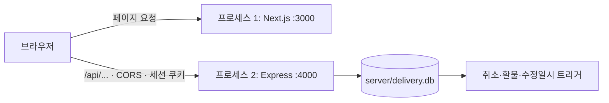
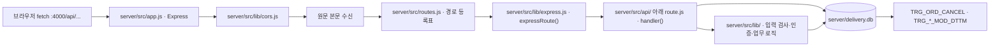
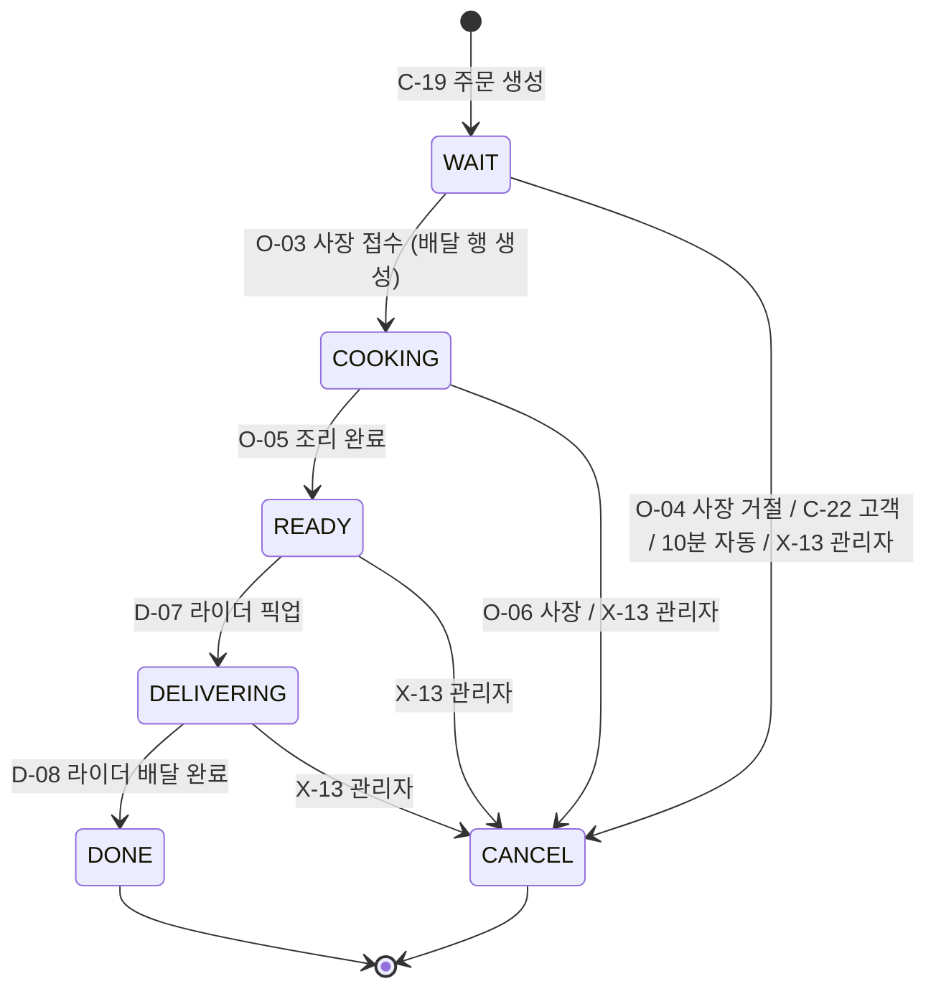

# 백엔드 안내

이 문서는 우리 백엔드의 입구다. 처음 보는 팀원과 AI 에이전트가 구조를 파악하고 화면을 연결하거나 기능을 고칠 수 있게 쓴다. API별 요청·응답·오류는 [API 문서](api/README.md)에 있다. 아래 파일 경로는 별도 설명이 없으면 저장소 루트 기준이다.

## 1. 한눈에 보기

- 고객·사장·라이더·관리자가 쓰는 배달 주문 서비스의 API다.
- API는 93개다(인증 A, 고객 C, 사장 S·M·O·R·T, 관리자 X, 라이더 D).
- 화면과 API는 별도 프로세스다. 루트의 Next.js는 화면만 맡고, `server/`의 Express는 API만 맡는다.
- DB는 SQLite 파일 하나(`server/delivery.db`)다. API 서버만 DB에 접근한다.



| 항목 | 내용 |
|---|---|
| 런타임 | Node.js 24 |
| 프레임워크 | 화면 Next.js 16.4.5, API Express 5.3.0 |
| DB | SQLite, `better-sqlite3` 12.11.1 (동기식 API) |
| 비밀번호 | Node 내장 `crypto.scrypt` |
| 세션 | HMAC 서명 쿠키 (Node 내장 `crypto`) |
| API 문서 화면 | `swagger-ui-dist` 5.35.0 |

### 폴더 구조

| 경로 | 역할 |
|---|---|
| `app/` | Next.js 화면. DB 코드와 API 핸들러는 두지 않는다. |
| `package.json` | 화면용 의존성과 `dev`, `build`, `start`, `lint` 명령. |
| `.env.example` | 화면 환경변수 예시. 로컬 설정 파일로 복사한다. |
| `server/package.json` | API 전용 의존성과 실행·검증 명령. |
| `server/src/index.js` | Express 서버 시작. 기본 포트는 4000이다. |
| `server/src/app.js` | CORS, 본문 수신, API 라우터, 문서 라우터, 404·오류 처리 순서. |
| `server/src/routes.js` | API 등록표. 메서드·경로·문서 ID·핸들러를 연결한다. |
| `server/src/api/` | API 핸들러. 경로 변수는 `[x]` 폴더로 표현한다. SQL은 기본적으로 해당 핸들러에 둔다. |
| `server/src/lib/express.js` | Express 요청·응답을 표준 Request·Response와 연결하는 `expressRoute()`. |
| `server/src/lib/cors.js` | 허용 origin과 쿠키를 위한 CORS 응답. |
| `server/src/lib/db.js` | 실행 폴더와 관계없이 `server/delivery.db`를 연다. 외래키 검사를 켠다. |
| `server/src/lib/password.js` | `hashPassword`, `verifyPassword` (scrypt). |
| `server/src/lib/http.js` | `handler()` 응답 형식·오류 변환, `fail()`, `readJson()`, 입력·페이지 검사. |
| `server/src/lib/auth.js` | 세션 쿠키 발급·검증, `requireRole()`, `requireOwnStore()`. |
| `server/src/lib/orders.js` | 주문 상태 변경과 10분 미접수 자동 취소. |
| `server/src/lib/geo.js` | 라이더 기준 좌표 `RIDER_BASE`, 배달 반경, 거리 계산. |
| `server/src/lib/stores.js` | 가게 영업 상태와 영업시간 응답. |
| `server/src/lib/members.js` | 회원 응답, 비밀번호·가게 신청 입력 검사와 저장. |
| `server/src/lib/cart.js` | 장바구니 조회·금액 계산, 주문 가능 검사와 주문 생성. |
| `server/src/lib/customer-stores.js` | 고객 주소 확인과 고객용 가게 조회. |
| `server/src/lib/owner-menus.js` | 사장 가게 상세와 메뉴·분류·옵션 로직. |
| `server/src/lib/owner-orders.js` | 사장 가게·주문 확인과 매출 기간 계산. |
| `server/src/lib/admin.js` | 활성 제재 조건과 관리자 취소 가능 상태. |
| `server/src/lib/rider.js` | 라이더 배달 응답 조회. |
| `server/db/schema.sql` | 테이블 23개, CHECK·UNIQUE·FK·인덱스. |
| `server/db/views.sql` | VIEW 2개. |
| `server/db/triggers.sql` | 트리거 18개. |
| `server/db/seed.sql` | 시연 데이터. |
| `server/scripts/init-db.mjs` | DB 초기화 (루트 `npm run db:init`). |
| `server/scripts/db-check.mjs` | 스키마·트리거·VIEW 검사 (루트 `npm run db:check`). |
| `server/scripts/api-smoke.mjs` | 실제 HTTP로 주요 흐름 확인 (루트 `npm run api:smoke`). |
| `server/scripts/gen-openapi.mjs` | API 마크다운에서 OpenAPI 생성 (루트 `npm run docs:openapi`). |
| `server/docs/api/` | API 계약. [공통 규칙·전체 목록](api/README.md), [인증](api/auth.md), [고객](api/customer.md), [사장](api/owner.md), [관리자](api/admin.md), [라이더](api/rider.md). |
| `server/docs/api/openapi.json` | 생성된 OpenAPI 3 명세. 손으로 고치지 않는다. |
| `server/src/api-docs.js` | `/api-docs` Swagger UI와 `/api-docs/openapi.json`. 정적 파일은 API 서버가 제공한다. |

## 2. 실행 방법

```sh
npm run dev:server   # 터미널 1: API :4000
npm run dev:web      # 터미널 2: 화면 :3000
```

Node.js 24를 쓴다. 위 명령은 모두 저장소 루트에서 실행한다.
명령 하나가 서버 하나를 실행한다. 동시 실행 스크립트는 없으므로 터미널 두 개를 쓴다.
`dev:server`는 Node의 `--watch`로 API를 실행한다. `dev:web`과 기존 `npm run dev`는 Next.js 화면만 실행한다.

### 처음 한 번 준비

저장소 루트에서 실행한다.

```sh
node -v              # v24.x
npm ci
npm run setup:server
npm run db:init
cp .env.example .env.local
```

- `npm ci`는 화면 의존성을 설치한다. `setup:server`는 `npm --prefix server ci`로 API 의존성을 설치한다.
- `.env.local`은 위 복사 명령으로 만드는 로컬 파일이다. Git에 올리지 않는다.
- PowerShell에서는 복사 명령으로 `Copy-Item .env.example .env.local`을 쓴다.
- seed 없이 빈 DB가 필요하면 루트에서 `npm run db:init -- --empty`를 실행한다.
- `npm run db:init`은 기존 `server/delivery.db`를 지운다. API 서버를 끄고 초기화한 뒤 다시 켠다.

### 운영 실행

API는 루트에서 `npm run start:server`로 실행한다. API 빌드는 필요 없다.
이 명령은 server 패키지의 시작 명령으로 위임한다.
시작 명령은 `server/.env`를 읽고 `--production` 플래그를 전달한다.
플래그는 코드에서 `NODE_ENV=production`을 설정한다. 환경변수로 같은 값을 지정해도 운영 모드다.
운영 모드에서 `SESSION_SECRET`이 없으면 아래 메시지를 출력하고 종료 코드 1로 끝난다.

```text
API 서버를 시작하지 못했습니다: 운영 모드(NODE_ENV=production)에는 SESSION_SECRET 환경변수가 필요합니다.
```

먼저 긴 임의 문자열을 만든다.

```sh
node -e "console.log(require('crypto').randomBytes(32).toString('hex'))"
```

아래 세 방법 중 하나를 쓴다. 예시 문자열은 생성한 값으로 바꾼다.

1. `server/.env`를 만들고 `SESSION_SECRET=<긴 임의 문자열>` 한 줄을 저장한다. 루트에서 `npm run start:server`를 실행한다. 이 파일은 Git에서 제외되며 운영 시작 명령만 읽는다.
2. bash/zsh: `SESSION_SECRET="<긴 임의 문자열>" npm run start:server`
3. PowerShell: `$env:SESSION_SECRET="<긴 임의 문자열>"; npm run start:server`

화면은 다른 터미널에서 실행한다.

```sh
npm run build
npm run start:web
```

server 폴더에서 API를 직접 개발 실행하려면 `cd server && npm run dev`를 쓴다.

- API 문서 화면은 `http://localhost:4000/api-docs`다. 개발·운영 모두 열린다.
- Swagger UI는 외부 인터넷 없이 동작한다. "Try it out"은 API 서버의 실제 API를 부른다.
- A-01 로그인을 먼저 실행하면 이후 요청에 세션 쿠키가 이어진다.
- API 마크다운을 고쳤으면 루트에서 `npm run docs:openapi`로 명세를 다시 만든다.
- Windows PowerShell에서 npm 실행이 막히면 `npm.cmd`를 쓴다.

### 환경변수

| 실행 위치 | 이름 | 기본값·설정 방법 | 운영 조건 |
|---|---|---|---|
| 루트 Next.js | `NEXT_PUBLIC_API_BASE` | `.env.example`을 `.env.local`로 복사한다. 예시 값은 `http://localhost:4000`이다. | 실제 API origin으로 설정하고 화면을 다시 빌드한다. 끝에 `/api`를 붙이지 않는다. |
| 루트 Next.js | `NEXT_PUBLIC_USE_MOCK` | 같은 로컬 파일의 예시 값은 `false`다. | 실제 API를 쓰려면 `false`로 설정한다. |
| server Express | `PORT` | 프로세스 환경변수. 기본 4000. 운영 시작에서는 `server/.env`도 읽는다. | API가 받을 포트로 지정한다. |
| server Express | `CORS_ORIGINS` | 기본 `http://localhost:3000`. 여러 origin은 쉼표로 나눈다. | 실제 화면 origin을 명시한다. `*`는 서버 시작 때 거부한다. |
| server Express | `SESSION_SECRET` | 프로세스 환경변수 또는 운영 시작이 읽는 `server/.env`. 개발에서만 기본 키를 쓴다. | 충분히 긴 비밀 키가 필수다. 없으면 서버가 시작하지 않고 종료 코드 1로 끝난다. |
| server Express | `NODE_ENV` | `start:server`의 `--production`이 코드에서 `production`으로 설정한다. 환경변수로도 지정할 수 있다. | 운영 모드에서는 세션 쿠키에 `Secure`가 붙으므로 HTTPS가 필요하다. |

- 개발 명령 `dev:server`는 `server/.env`를 읽지 않는다. 필요한 개발 설정은 프로세스 환경변수로 전달한다.
- 서버 시간대는 한국 시간이라고 가정한다. 일시는 SQLite `datetime('now', 'localtime')`으로 기록한다.

### 시연 계정 (`npm run db:init` 후)

모든 계정의 비밀번호는 `test1234`다.

| 역할 | 이메일 | 회원 ID | 참고 |
|---|---|---|---|
| 관리자 | `admin@test.com` | 1 | |
| 사장 | `owner1@test.com` ~ `owner3@test.com` | 2~4 | 가게 1~3 승인, 4 대기, 5 반려 |
| 라이더 | `rider1@test.com` ~ `rider4@test.com` | 5~8 | |
| 고객 | `customer1@test.com` ~ `customer4@test.com` | 9~12 | 포인트 잔액과 주문 이력이 있다 |
| 탈퇴 회원 | - | 13 | 로그인할 수 없다 |

- seed의 WAIT 주문 2건은 `db:init` 시각 기준 1~2분 전에 들어간다. 10분이 지나면 자동 취소 대상이 된다.

## 3. 화면 연결

화면을 연결할 때 루트 환경변수를 아래처럼 설정한다. 현재 루트 화면은 시작 페이지다. 역할별 화면의 API 호출도 같은 규칙으로 연결한다.

```sh
NEXT_PUBLIC_API_BASE=http://localhost:4000
NEXT_PUBLIC_USE_MOCK=false
```

- 환경변수를 바꾸면 Next.js 개발 서버를 다시 켠다.
- 화면의 요청 주소는 `${NEXT_PUBLIC_API_BASE}/api${path}`다. `path`는 `/auth/login`처럼 `/api`를 제외한 경로다.
- `fetch`에 `credentials: 'include'`를 준다. API를 Next.js 경로로 프록시하지 않는다.

### CORS

- 두 localhost 주소는 포트가 달라 origin이 다르다. 브라우저가 Express API를 직접 부르므로 CORS가 필요하다.
- 허용된 origin에만 해당 origin의 `Access-Control-Allow-Origin`과 `Access-Control-Allow-Credentials: true`를 준다.
- 모든 응답에 `Vary: Origin`을 준다.
- OPTIONS는 라우트에 들어가지 않고 204로 끝난다.
- 허용된 origin의 preflight에는 GET·POST·PUT·PATCH·DELETE·OPTIONS와 `Content-Type`을 허용한다.
- 허용되지 않은 origin에는 Allow-* 헤더를 주지 않는다. 브라우저가 응답을 읽지 못하며, CORS가 서버의 인증을 대신하지는 않는다.

### 공통 형식
- 요청 본문은 JSON이다.
- 성공: `{ "success": true, "data": ... }`
- 실패: `{ "success": false, "error": { "code": "...", "message": "...", "fields": { ... } } }`. `fields`는 입력 오류(400)일 때만 있다.
- 화면은 `message`를 보여 주고, 분기는 `code`로 한다.
- 페이지 목록은 `data = { items, page, size, totalCount }`다. 페이지가 없는 목록은 `data`가 배열이다.
- 자세한 규칙과 오류 코드는 [api/README.md](api/README.md#공통-규칙)에 있다.

### 세션
- 로그인(A-01)하면 서버가 `delivery_session` 쿠키를 준다. `HttpOnly; SameSite=Lax; Path=/`이며 수명은 24시간이다.
- 화면은 쿠키를 직접 다루지 않는다. 요청마다 `credentials: 'include'`를 준다.
- `http://localhost:3000`과 `http://localhost:4000`은 origin은 다르지만 같은 site다. 그래서 Lax 쿠키를 쓸 수 있다.
- 서로 다른 site에 배포하려면 `SameSite=None; Secure`와 HTTPS가 필요하다. 현재 쿠키 구현은 이 구성을 지원하지 않으므로 배포 전에 별도 변경해야 한다.
- production에서는 현재 Lax 쿠키에도 `Secure`가 붙는다.
- 서버는 요청마다 회원이 활성 상태인지와 역할을 다시 확인한다.

### 역할별 화면을 연결할 때 확인할 점
- 메서드와 경로는 API 문서를 따른다.
- A-08 내 정보 수정은 `PATCH /api/auth/me`다. 이름·연락처·비밀번호를 수정한다.
- X-13 관리자 주문 취소의 `reasonDetail`은 사유가 `ETC`면 필수다.
- C-24·C-25 리뷰 내용: 생략하거나 빈 문자열이면 `null`로 저장한다. 응답의 `content`는 `null`일 수 있다.
- 사장 경로의 `{storeId}`: 없거나 삭제된 가게면 404, 다른 사장의 가게면 403이다.
- 그 밖에 필드 이름 복원, 응답 보완 같은 API별 차이는 [api/README.md의 "원본 명세서 대비 변경"](api/README.md#원본-명세서-대비-변경)에 있다.

## 4. 요청 흐름



주문 상태는 아래처럼만 바뀐다. 표에 없는 변경은 409 `ORDER_ALREADY_PROCESSED`다.



- 라이더 배차(D-05)는 주문 상태를 바꾸지 않는다. COOKING·READY 주문에 배차를 받을 수 있다.
- 10분 미접수 자동 취소는 예약 작업이 아니다. 주문을 읽는 API가 조회 전에 만료된 WAIT 주문을 SYSTEM 취소한다. 접수·거절·고객 취소는 같은 트랜잭션에서 만료를 확인하고, 만료면 자동 취소를 커밋한 뒤 409를 준다.

## 5. DB

### 테이블 23개

| 테이블 | 한 줄 설명 |
|---|---|
| `TB_MBR` | 회원 공통 계정. 역할(CUSTOMER·OWNER·RIDER·ADMIN), 상태(ACTIVE·WITHDRAWN), 포인트 잔액. |
| `TB_MBR_ADDR` | 고객 배달 주소. 좌표 필수, 회원당 기본 주소 1개. |
| `TB_RIDER` | 라이더 전용 정보. 상태(IDLE·BUSY), 운송수단, 활동 반경. |
| `TB_STORE` | 가게. 카테고리, 좌표, 최소 주문금액, 배달팁, 기본 조리시간, 영업 상태, 현재 승인 상태. |
| `TB_STORE_HOURS` | 요일별 영업시간. 한 요일에 여러 행이면 브레이크타임, 행이 없으면 휴무. |
| `TB_STORE_APRV` | 입점 신청·승인·반려 이력. 재신청하면 새 행. |
| `TB_MENU_CTGR` | 가게 안 메뉴 분류. |
| `TB_MENU` | 메뉴. 금액, 판매 상태(ON_SALE·SOLD_OUT). |
| `TB_MENU_OPT_GRP` | 메뉴의 옵션 그룹. 필수 여부, 최대 선택 수. |
| `TB_MENU_OPT` | 옵션 그룹의 옵션. 추가 금액. |
| `TB_CART` | 회원당 장바구니 1개. 한 가게의 메뉴만 담는다. |
| `TB_CART_DTL` | 장바구니 항목. 같은 메뉴라도 옵션 구성이 다르면 별도 행. |
| `TB_CART_DTL_OPT` | 장바구니 항목의 선택 옵션. |
| `TB_ORD` | 주문. 상태, 금액(배달팁 제외)·배달팁, 배달지 스냅샷, 접수·취소 정보. |
| `TB_ORD_DTL` | 주문 메뉴. 메뉴명·단가 스냅샷. |
| `TB_ORD_DTL_OPT` | 주문 옵션. 옵션 그룹명·옵션명·금액 스냅샷. |
| `TB_PAY` | 결제. 주문당 1건, 수단(CARD·KAKAO·NAVER·POINT), 상태. |
| `TB_PNT_TXN` | 포인트 원장. CHARGE·USE·REFUND·EXPIRE, 거래 후 잔액. |
| `TB_DLVR` | 배달. 사장 접수 때 생성. 라이더·배차·픽업·완료 일시(상태 컬럼 없음). |
| `TB_RVW` | 리뷰. 주문당 1건, 평점 1~5, 내용 NULL 허용, 숨김·삭제 여부. |
| `TB_RVW_REPLY` | 사장 답글. 리뷰당 1건(삭제 후 다시 달면 행을 되살림). |
| `TB_RVW_RPT` | 리뷰 신고와 관리자 처리 결과. |
| `TB_MBR_RSTR` | 리뷰 작성 제한 이력. 종료일시가 NULL이거나 미래면 활성. |

- 테이블은 SQLite STRICT다. 일시는 TEXT `YYYY-MM-DD HH:MM:SS`, 금액은 원 단위 INTEGER다.
- 컬럼 정의와 제약은 `server/db/schema.sql`의 주석에 있다.

### VIEW 2개

| VIEW | 내용 | 쓰는 API |
|---|---|---|
| `V_STORE_RATING` | 가게별 평균 평점(소수 1자리)·리뷰 수. 숨김·삭제 리뷰 제외. 리뷰 0건 가게도 행이 있다(평점 NULL). | C-08, C-09, C-12, S-01, R-01 |
| `V_DONE_ORDER` | 배달 완료(DONE) 주문. 매출 날짜 = 배달 완료 날짜, 주문금액(배달팁 제외), 배달팁. | T-01, T-02 |

### 트리거 18개

| 트리거 | 언제 | 무엇을 |
|---|---|---|
| `TRG_<테이블>_MOD_DTTM` (17개) | MOD_DTTM이 있는 테이블을 UPDATE한 뒤 | UPDATE에서 MOD_DTTM을 직접 바꾸지 않았으면 현재 시각을 기록한다. |
| `TRG_ORD_CANCEL` | `TB_ORD.ORD_STTS`가 CANCEL로 바뀐 뒤 (주문마다) | 결제를 CANCELED로 바꾼다. 승인된 POINT 결제면 잔액을 돌려주고 REFUND 거래를 기록한다. 배차된 라이더의 배달이 끝나지 않았으면 라이더를 IDLE로 돌린다. |

**트리거가 하는 일은 코드에서 다시 하지 않는다.**
- 주문 취소 API는 `TB_ORD`를 CANCEL로 바꾸기만 한다. 결제 취소·환불·라이더 IDLE은 트리거가 한다.
- UPDATE 문에 `MOD_DTTM`을 넣지 않는다.
- 다시 하면 이중 환불이 생긴다. `TB_PNT_TXN`의 부분 UNIQUE 인덱스(주문당 REFUND 1건)가 마지막으로 막는다.

트리거가 하지 않고 API가 같은 트랜잭션에서 하는 일:
- 배차 수락 때 라이더 BUSY (D-05)
- 배달 완료 때 라이더 IDLE (D-08)
- 입점 승인 상태 동기화: `TB_STORE_APRV`와 `TB_STORE.STORE_APRV_STTS` (A-05, X-03, X-04)

## 6. 원본 명세서·ERD와 달라진 결정

| 결정 | 이유 |
|---|---|
| 라이더 위치는 숭실대 좌표 상수(37.4963, 126.9575). `TB_RIDER`에 기준 좌표 컬럼 없음 | 최신 라이더 명세(D-04) 기준. 상수는 `server/src/lib/geo.js` 한 곳에만 둔다. |
| 운송수단 4개: WALK, BICYCLE, MOTORCYCLE, CAR | 라이더 명세 기준. OTHER 제거. |
| 리뷰 내용 `RVW_CN` NULL 허용. 생략·빈 문자열이면 NULL | 11/12 ERD 기준. 고객 명세의 "빈 문자열 저장" 문구는 고쳤다. |
| 가게 카테고리 8개: CHICKEN, PIZZA, KOREAN, CHINESE, JAPANESE, SNACK, CAFE, ETC | 명세에서 미확정이던 코드를 임시 8개로 확정. |
| 여러 테이블에 걸친 검사는 서버 코드가 한다 | 리뷰 작성 조건, 장바구니 가게 일치, 답글 작성자, 활성 제재 중복, 주문↔배달 상태는 SQLite CHECK로 표현할 수 없다. 검사용 트리거는 만들지 않았다. |
| 한 테이블 안의 규칙은 스키마 제약으로 넣었다 | 취소 상태 ⇔ 취소 일시·주체, 접수 이후 ⇔ 접수 일시·조리분, 회원당 기본 주소 1개, 배차 ≤ 픽업 ≤ 완료 등. DB가 마지막 방어선이다. |
| 탈퇴한 회원의 이메일로 다시 가입할 수 있다 | 이메일은 활성 회원 사이에서만 UNIQUE(`UK_MBR_EMAIL_ACTIVE`). 탈퇴 행은 원래 이메일을 유지해 과거 주문을 추적할 수 있다. |
| 취소 사유 코드는 취소 주문에 필수. 고객 취소는 `CUSTOMER_REQUEST`, 자동 취소는 `NO_RESPONSE` | 명세서 기준(팀 결정). |
| `TB_STORE.COOK_EST_MI`는 기본 조리시간(분) | 11/12 ERD의 `DLVR_EST_MI` → `COOK_EST_MI` 변경. |
| `TB_DLVR`에 상태 컬럼 없음 | 주문 상태와 겹친다. 배차·픽업·완료는 일시 컬럼으로 판단한다(11/12 ERD). |
| 포인트 1회 충전 상한 없음(10,000원 단위) | 팀 결정. |
| 장바구니 항목 수량 상한 없음 | 팀 결정. |
| `replaceCart=true`면 기존 장바구니를 비우고 새 가게로 교체 | 팀 결정. |
| 같은 메뉴·같은 옵션 구성이면 수량 합산, 옵션이 다르면 별도 항목 | 팀 결정. |
| 판매 중인 메뉴가 0개가 되어도 가게 영업 상태는 그대로, 주문만 막는다 | 팀 결정. 주문 API(C-18, C-19)의 판매 가능 검사가 막는다. |
| X-13 관리자 취소에 `reasonDetail` 추가(ETC면 필수) | 팀 결정. 상담 메모와 취소 상세 사유를 구분한다. |
| A-08 `PATCH /api/auth/me` 신설 | 팀 결정. 라이더 명세가 안내한 이름·연락처·비밀번호 수정 기능. |
| 사장이 탈퇴하면 소유 가게를 모두 논리 삭제하고 PAUSED로 | 팀 결정. |
| 세션은 HMAC 서명 쿠키, production에서는 `SESSION_SECRET` 필수 | 세션 테이블 없이 구현한다. 공개된 개발 키로 쿠키를 위조하지 못하게 한다. |
| 화면과 API를 물리적으로 분리하고 API는 Express로 실행한다 | 과목 요구사항이다. Next.js는 화면만 맡는다. Express는 기존 표준 Request·Response 핸들러를 연결하면서 라우트·CORS·서버 시작을 명시적으로 관리한다. |

- API별 세부 변경은 [api/README.md의 "원본 명세서 대비 변경"](api/README.md#원본-명세서-대비-변경)에 있다.

## 7. 새 API 추가·수정 방법

1. 해당 영역의 API 문서와 [전체 목록](api/README.md)을 고친다. 요청·응답·오류·DB 처리 형식을 유지한다.
2. `server/src/api/` 아래에 경로별 폴더와 `route.js`를 만든다. 예를 들어 `server/src/api/customer/addresses/[addressId]/route.js`다. `{x}` 경로 변수는 `[x]` 폴더다.
3. 핸들러는 아래 형태를 따른다. import는 server 패키지의 `#lib/*` 별칭을 쓴다.

```js
import db from "#lib/db";
import { requireRole } from "#lib/auth";
import { fail, handler, pathId, readJson, str } from "#lib/http";

// PATCH /api/customer/addresses/{addressId} 의 축약 예
export const PATCH = handler(async ({ request, params }) => {
  const me = requireRole(request, "CUSTOMER");          // 401·403 은 여기서 끝난다
  const addressId = pathId(params.addressId, "addressId");
  const body = await readJson(request);
  const name = str(body.addressName, "addressName", { max: 30 }); // 잘못되면 400 VALIDATION_ERROR

  const address = db.prepare("SELECT MBR_ID FROM TB_MBR_ADDR WHERE MBR_ADDR_ID = ? AND DEL_YN = 'N'").get(addressId);
  if (!address) fail(404, "NOT_FOUND", "주소를 찾을 수 없습니다.");
  if (address.MBR_ID !== me.MBR_ID) fail(403, "FORBIDDEN", "내 주소가 아닙니다.");

  db.prepare("UPDATE TB_MBR_ADDR SET MBR_ADDR_NM = ? WHERE MBR_ADDR_ID = ?").run(name, addressId); // MOD_DTTM 은 트리거
  return { addressId, addressName: name };               // 200 { success: true, data }
});
```

- 201이 필요하면 `return created({ ... })`를 쓴다. `created`도 `#lib/http`에서 가져온다.
- 쿠키를 설정하려면 `return ok(data, { headers: { "Set-Cookie": ... } })`를 쓴다.
- 사장 경로는 `requireOwnStore(me, storeId)`로 가게 소유를 확인한다.
- 여러 테이블이나 여러 행을 쓰면 `db.transaction(() => { ... })()` 하나로 묶는다.
- 주문 상태 변경은 `server/src/lib/orders.js`의 `transitionOrder()` 또는 `cancelOrder()`를 쓴다.
- 주문을 읽는 API는 먼저 `expireWaitingOrders()`를 호출한다.
- SQL은 해당 핸들러 안에 둔다. 두 개 이상의 핸들러가 쓰는 로직만 `server/src/lib/`로 옮긴다.

4. `server/src/routes.js`에서 핸들러를 import하고 `expressRoute()`로 등록한다. 문서 ID 주석을 붙인다.
5. 같은 깊이의 고정 경로는 `:param` 경로보다 먼저 등록한다. 예를 들어 메뉴 정렬 경로는 메뉴 ID 경로보다 앞이다.
6. 루트에서 `npm run docs:openapi`를 실행한다. 생성된 명세도 변경에 포함한다.
7. 중요한 흐름이면 `server/scripts/api-smoke.mjs`에 단계를 추가한다.
8. 아래 검증을 실행한다.

## 8. 검증 방법

아래 명령은 모두 저장소 루트에서 실행한다.

| 명령 | 확인하는 것 |
|---|---|
| `npm run db:init` | DB를 schema → views → triggers → seed 순서로 다시 만든다. 기존 데이터는 지워진다. |
| `npm run db:check` | 메모리 DB에서 취소 환불·라이더 IDLE·일괄 자동 취소·MOD_DTTM, VIEW, CHECK, 탈퇴 이메일 재가입을 assert로 확인한다. |
| `npm run docs:openapi -- --check` | API 마크다운과 생성된 명세가 같은지 확인한다. 다르면 `npm run docs:openapi`로 명세를 다시 만든다. |
| `npm run api:smoke` | DB를 초기화하고 별도 Express 서버를 띄워 실제 HTTP를 호출한다. 로그인·권한·입력 오류·주문~배달~리뷰~매출·취소 환불·관리자 취소·10분 만료·재가입 8개 시나리오를 확인한다. Next.js 빌드는 필요 없다. |
| `npm run lint` | 화면 ESLint 검사. |
| `npm run build` | 화면 프로덕션 빌드. |

- 각 명령은 실패하면 0이 아닌 exit code를 낸다.

## 9. AI 에이전트용 요약

지켜야 할 불변 규칙:
- 루트에는 화면만 둔다. DB 코드와 API 핸들러를 추가하지 않는다.
- API와 DB 코드는 모두 `server/` 안에 둔다. Next.js와 Express는 별도 프로세스로 유지한다.
- API 계약은 `server/docs/api/`의 마크다운이다. 경로·필드·오류 코드를 바꾸면 문서를 먼저 고친다.
- 루트에서 `npm run docs:openapi`를 실행한다. 생성된 명세는 손으로 고치지 않는다.
- API를 추가하면 `server/src/routes.js`에도 문서 ID와 함께 등록한다. 고정 경로를 변수 경로보다 먼저 둔다.
- 응답은 항상 `handler()`를 거친다. 성공 `{ success: true, data }`, 실패 `{ success: false, error: { code, message, fields? } }`.
- 인증은 `requireRole()`로 한다. 쿠키의 역할을 믿지 않고 요청마다 `TB_MBR`을 읽는다.
- 화면 요청에는 API base URL과 `credentials: 'include'`를 쓴다. CORS 허용 origin은 명시한다.
- 주문 상태 변경은 `server/src/lib/orders.js`로만 한다. 조건부 UPDATE이고, 바뀐 행이 0이면 409다.
- 트리거가 하는 일(취소 후 결제 취소·환불·라이더 IDLE, `MOD_DTTM`)은 코드에서 다시 하지 않는다.
- 라이더 BUSY(D-05)·IDLE(D-08)과 입점 승인 상태 동기화는 API가 같은 트랜잭션에서 한다.
- 여러 테이블 쓰기는 `db.transaction()` 하나로 묶는다.
- 여러 테이블에 걸친 검사는 서버 코드가 한다. 한 테이블 안의 규칙은 스키마 제약이 마지막으로 막는다.
- 라이더 기준 좌표는 `server/src/lib/geo.js`의 `RIDER_BASE` 하나뿐이다.
- 현재 시각은 SQL `datetime('now', 'localtime')`로 쓴다.
- 새 npm 의존성은 꼭 필요한 경우에만 해당 패키지에 추가한다. 화면과 API의 패키지를 섞지 않는다.
- 스키마를 바꾸면 루트에서 `npm run db:init`, `npm run db:check`를 다시 실행한다.
- 루트의 `AGENTS.md`는 Next.js가 만드는 파일이다. 커밋하지 않는다.
